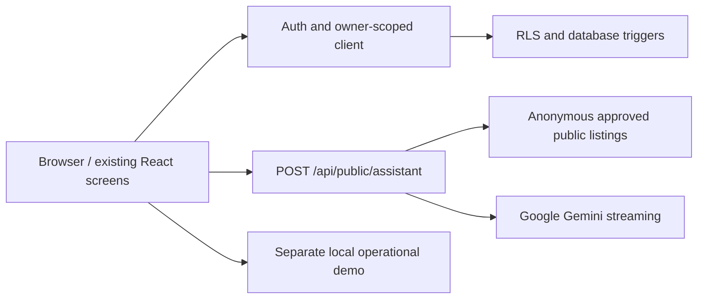

# The Azure Ridge Sanctuary

An AI Resort Guest Experience & Operations Platform built with React, TypeScript, TanStack Start, Tailwind CSS and the current Lovable Cloud database/authentication integration.

## Problem and objectives

Guests need a single place to explore stays, plan activities, request reservations and manage their private account. Resort teams need separate, permission-controlled business and management tools. The project demonstrates those workflows without pretending that live availability, payments or resort policy details are confirmed.

## Five feature areas

| Area              | Existing screens and responsibilities                                                                                                              |
| ----------------- | -------------------------------------------------------------------------------------------------------------------------------------------------- |
| Resort Homepage   | `/`: resort introduction, accommodation, dining and facilities; floating guest assistant                                                           |
| Guest Experience  | `/sign-up`, `/auth`, `/rooms`: account creation, room search/filter/sort/details and booking requests                                              |
| AI Concierge      | Home assistant and `/dashboard#assistant`: streamed Gemini conversation; `/dashboard#concierge`: existing deterministic personalized planning form |
| Guest Dashboard   | `/dashboard` with sidebar sections for bookings, upcoming/past stays, profile, activities and support                                              |
| Resort Operations | `/owner`, `/admin`, `/front-desk`, `/operations`: owner/admin database tools and staff-only operational demonstrations                             |

These are feature groupings, not five newly created pages. Existing URLs, information pages and role-based navigation remain intact. See [user flow](docs/USER_FLOW.md).

## Technology and architecture

- React 19 and TypeScript; TanStack Start/Router for routing and server endpoints.
- Tailwind CSS 4 and the existing shared design components.
- TanStack Query for cached profile and owner/admin queries.
- Generated database client and Auth integration in `src/integrations/supabase/`.
- PostgreSQL Row Level Security (RLS) and SQL triggers; private listing photo storage.
- Direct Google Gemini REST streaming through a server endpoint, using a Google AI Studio key.
- AI Elements for conversation, messages, composer and loading states.
- Vitest for validation, parsing, pricing and live guest privacy checks.



## Important source files

```text
src/
  assets/                   Local resort photography
  components/
    AssistantWidget.tsx     Floating Gemini chat and in-memory conversation
    AuthForm.tsx            Existing signup/signin/Google/reset forms
    BookingDialog.tsx       Validated pending booking requests
    DashboardSidebar.tsx    Collapsible desktop sidebar and mobile drawer
    AccountMenu.tsx         Authenticated email, existing account links, sign-out
    ai-elements/            Installed transcript/message/composer primitives
    guest/                  Shared rooms, activities, profile, support, planning
    owner/                  Owner property, room, pricing, reservation/photo tools
    admin/                  Approvals, permissions, users, audit/settings tools
  data/resort.ts             Central demonstration catalogue and operational samples
  data/guest-information.ts Honest policy/FAQ/contact information status
  integrations/supabase/    Generated auth/client/server/types integration
  lib/store.tsx             Private bookings/state; separate local operational samples
  lib/assistant-contract.ts Validated chat request and Gemini text/refusal parsing
  lib/admin.functions.ts    Authenticated, superadmin-verified privileged actions
  routes/                   Existing public and protected content routes
  routes/api/public/assistant.ts Same-origin, validated catalogue-only Gemini streaming
  start.ts                  Auth bearer, error and CSRF middleware
  server.ts                 Server error wrapper
  test/                     Existing and new tests
drizzle/migrations/          Nine ordered SQL migrations and their metadata
public/                      Favicon and robots configuration
```

## Database and data flow

The project uses its existing Lovable Cloud backend, not an independently connected external database. The latest Week 1 update adds validation triggers and owner safeguards without new tables or disabling RLS. All 12 existing public tables have RLS enabled.

| Existing table        | Purpose                                                                                     |
| --------------------- | ------------------------------------------------------------------------------------------- |
| `profiles`            | Auth-linked private full name, mobile and language                                          |
| `user`                | Trigger-maintained name/email/phone/role/timestamps account summary; role is display-only   |
| `user_roles`          | Protected staff/superadmin authorizations                                                   |
| `guest_bookings`      | Owner-scoped pending reservation details; server validation prevents forged payment success |
| `guest_state`         | Owner-scoped JSON activity plans and enquiries                                              |
| `business_owners`     | Business application, approval status, contact details and permissions                      |
| `owner_properties`    | Owner-assigned properties, listing status, details, amenities and photo paths               |
| `owner_rooms`         | Capacity, prices, seasonal pricing, discounts, units and availability                       |
| `owner_reservations`  | Owner-managed reservations and guest details                                                |
| `owner_notifications` | Private owner notifications                                                                 |
| `platform_settings`   | Admin-controlled platform configuration                                                     |
| `admin_audit_log`     | Trigger-created audit history                                                               |

The nine SQL files under `drizzle/migrations/` are the schema source of truth. `drizzle/schema.ts` is intentionally a blank placeholder, not an ORM model. Public partner listings are projected through `public_listings()` with safe fields and approved owner/listing filtering. Photos reside in the private `listing-photos` bucket and use signed URLs. The assistant reads approved partner facts anonymously and strips unexpected fields; it never reads private guest records. The current public partner catalogue is empty.

For a separate deployment, apply the SQL files in journal order using a migration administrator and preserve grants/policies/triggers. Provision `listing-photos` separately as private storage with a 10 MB limit; storage bucket provisioning is not in the SQL chain. Never generate models from the blank Drizzle placeholder or blindly replay applied migrations. In Lovable, use the managed migration workflow. New triggers validate guest amounts/dates/capacity, saved array shapes and owner reservation ownership/pricing/units; unsafe partial property transfer is blocked.

### Real versus demonstration data

- Guest bookings, profiles, enquiries and activity plans: saved to current database, scoped by account.
- Enquiries now retain the entire submitted message, contact fields, dates, guest count and language. Older enquiries may contain only their original name/topic/date; missing message text is not invented.
- Owner/admin business records: existing database tools and policies; this update does not change them.
- Main room/activity/dining/facility catalogue: static demonstration data; not live inventory.
- Front desk reservations: sample operational records; edits are in memory.
- Housekeeping/readiness/tasks: sample data, persisted locally under `azure-ridge-demo-v1`; not shared production operations.
- Sidebar preference: localStorage `azure-sidebar-compact`.
- AI history: component memory only, lost on reload/navigation/unmount; preserved while opening/closing the widget and cleared on account changes. No database chat history.
- Payments: `Payment Ready/Test` is not paid. Requests remain Pending until genuine operations/payment integrations are supplied.

Guest-state writes run in a serial queue, wait for successful storage and then update the screen. Loading failures are visible; they never silently switch to demo bookings. The queue prevents overlapping requests within one app instance, not cross-tab/device conflicts.

## Authentication workflow

Signup validates name/email/phone/password/confirmation, calls Auth signUp and supplies profile metadata. Existing lifecycle triggers create `profiles` and `user` records without storing passwords. Without a session, the form asks the guest to confirm their email. Existing users sign in with email/password; Dashboard shows the actual session email and sessions persist across refresh. Profile edits update only name/mobile; triggers synchronize the account summary. Permissions come from `user_roles` and backend owner approval rules, never user metadata or the `user.role` display field.

Google consent and email delivery depend on the current hosted auth settings. This update did not change or fully test those provider settings. Staff URLs retain their existing role checks.

## Google AI Studio / Gemini configuration

1. Open Google AI Studio → API keys. Create/select a key in your Google project with Gemini API access.
2. Save it securely as server-only `GEMINI_API_KEY` using the project's secret form. Never put it in a frontend variable or commit it.
3. Default model: `gemini-3.5-flash`. Optional server-only `GEMINI_MODEL` can select a model available to your Google project. Google billing, quotas, regional availability and key restrictions apply.
4. Ask a question in the existing floating assistant. The browser posts language plus bounded conversation history to `/api/public/assistant`.
5. The endpoint validates same-origin requests and input, reads only approved public partner listings, supplies catalogue/policy grounding, calls `streamGenerateContent?alt=sse`, parses text deltas and streams newline-delimited JSON to the browser.
6. Loading, Stop and explicit Retry are available. Failed calls show an error, not a canned successful answer. Automatic retry loops are not used.

The saved key was tested: authenticated model listing returned HTTP 200 and included the selected model; a live endpoint and browser answer returned the actual ₹8,500 Deluxe room rate with the correct non-payment/non-confirmation warning. This verifies the API integration, not any manual configuration of the AI Studio workspace by the agent.

The public assistant does not query private data or change bookings. Same-origin and bounded requests are not a full abuse/rate-limit solution; production AI usage monitoring and provider quota controls remain necessary.

## Installation and environment

Use a current Node.js runtime and Bun; install dependencies with `bun install`, then `bun run dev`. The development page uses the configured Vite port (8080 in the Lovable sandbox).

Existing browser configuration: `VITE_SUPABASE_URL`, `VITE_SUPABASE_PUBLISHABLE_KEY` and `VITE_SUPABASE_PROJECT_ID`. These are generated public configuration, not service credentials. Preserve the generated client files. `.env.example` contains blank configuration slots only; store private values securely, never commit a populated secret-bearing file.

Server configuration: `SUPABASE_URL`, `SUPABASE_PUBLISHABLE_KEY`, privileged `SUPABASE_SERVICE_ROLE_KEY` when the hosting environment supplies it, `GEMINI_API_KEY`, optional `GEMINI_MODEL`, and existing managed `LOVABLE_API_KEY` for applicable platform integrations. Do not expose server credentials in `VITE_*`, source, logs or screenshots. Lovable Cloud manages its database credentials; it does not provide a downloadable service-role key.

## Tests and build

- `bun run test`: full Vitest suite. Live privacy tests need secured sandbox server credentials and skip elsewhere; they create and remove isolated temporary accounts.
- `bun run lint`: formatting/style check. Repository-wide pre-existing formatting failures remain; do not mistake these for successful lint.
- `bun run build`: production build outside the managed editor; the editor runs TypeScript checks and production builds automatically.
- Manual checks: Home → Rooms → details/request; signup/confirmation/login; refresh Dashboard; save and reload enquiry/activity/profile; sign out; private-data isolation; Gemini follow-up/context; mobile drawer/account menu and desktop collapse.

## Current limitations and future improvements

Live payment, verified resort policies/contact/location, live guest/partner inventory integration, full email-confirmation/Google-consent testing, shared operational persistence, cross-device guest-state conflict handling, photo-orphan cleanup, AI abuse controls and full privileged owner/admin browser regression remain outstanding. The existing planning form is deterministic; the guest assistant is a genuine Gemini conversation. Owner values represent bookings, not collected payments. Public partner checkout is not implemented. Owner room-edit reapproval and independent publish-only permissions still need completion.

## Current verification and resubmission

Latest checks: **39 tests passed in 8 files**; automatic TypeScript/production build **OK**; changed-file lint **0 errors** (one warning). Full repository lint still fails on **1,147 formatting errors and 18 warnings**; this is disclosed rather than hidden or disabled.

See [Week 1 technical report](docs/WEEK-1-TECHNICAL-REPORT.md), [evaluation checklist](docs/WEEK-1-EVALUATION-CHECKLIST.md), and [implementation report](docs/WEEK-1-IMPLEMENTATION-REPORT.md) for current checks and gaps. Older `WEEK_1_REPORT.md` and `EVIDENCE_CHECKLIST.md` record the previous improvement pass, not the latest completion audit.

Latest browser verification used temporary confirmed accounts: login/refresh, edited-profile booking prefill, pending booking save/readback/cancel, full enquiry/activity persistence, guest admin denial, mobile drawer and logout succeeded; a real Gemini answer reflected the public database catalogue. Placeholder signup emails are blocked by the hosted service, with a clear actual error—real inbox confirmation/recovery remains manual. Do not claim production readiness or all five evaluation requirements COMPLETE until the checklist evidence is supplied.
