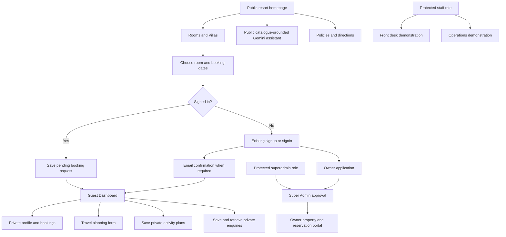

# Azure Ridge user flow

The five feature areas organize existing functionality; they do not replace existing pages or navigation.

## Boundaries

- Home, rooms, policies and directions are public.
- Guest personal information stays behind authentication and owner-scoped RLS.
- A new account is not a staff/admin authorization. Business access requires approval.
- Catalogue assistant answers do not confirm bookings, retrieve private records or take money.
- Operational sample data is not the private guest database.
